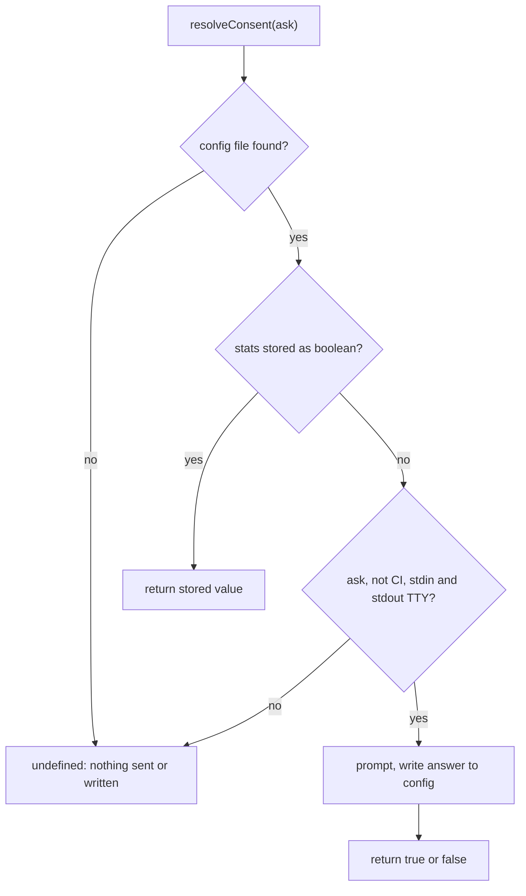

<!-- qoq-scribe sources: src/cli.ts src/config.ts src/stats.ts src/format.ts -->

# CLI, config file and stats

## Overview

> Source: documented from plan

`justify-disable [...paths] [--json] [--concurrency <n>]` resolves consent, calls `lint()`, prints the result with `format()` and exits 0 (passed; warnings alone still pass), 1 (at least one error-severity violation) or 2 (any thrown error). Under `--json` errors are printed to stdout as `{ passed: false, error }` so stdout stays parseable; otherwise they go to stderr.

## Config file discovery

> Source: documented from plan

`loadConfig()` uses a module-level cosmiconfig explorer, so repeated searches read the file once. `searchConfig()` is shared with stats because consent is stored in the same file. No file means `{}` (defaults); a non-object export throws.

## Usage stats and consent

> Source: documented from plan

<!-- qoq-artist id: consent-resolution -->

Consent has three states: `true`, `false`, and `undefined` (never asked). A run that cannot ask (CI, no TTY, `--json`, or no config file to record the answer in) stays `undefined`: nothing is sent or written, and the next interactive run asks again. Only an answer is written back, which is what stops the asking.

The answer is spliced into the user's own config source with a regex rather than re-serialized, to keep their comments and formatting. It handles an inline exported object and a named `const` that is default-exported; any other shape prints a warning asking the user to add `stats` by hand.

The CLI sends stats itself and passes `stats: false` to `lint()`, and awaits the send, because `process.exit` would kill the fire-and-forget request that a library call can afford. `lint()` never prompts: a library caller's `stats` option is the whole decision. Only the literal tool name is sent; transport lives in `@ladamczyk/qoq-utils`.
